<h1 align="center">
   
    
   
  Chudder
   
</h1>

<h4 align="center">Casts to any Chromecast, AirPlay or DLNA device from every platform. Keeps SyncPlay in step over the internet. Works from a TV remote.</h4>

An opinionated fork of <a href="https://github.com/DonutWare/Fladder">Fladder</a>, the cross-platform Jellyfin client built with <a href="https://flutter.dev/">Flutter</a>. Windows · macOS · Linux · Android · Android TV · iOS · Web

  
  
  
  
  

https://github.com/user-attachments/assets/c2d42151-d4a5-423d-a310-0b0d5ab0a919

  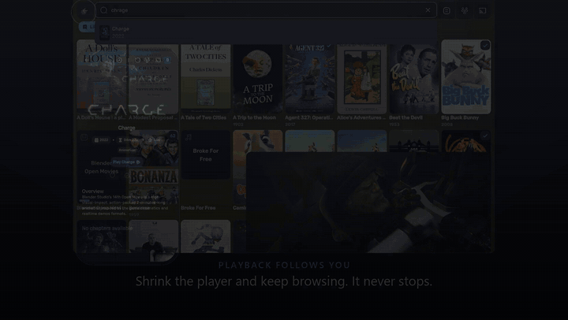

  <a href="#what-chudder-adds">What Chudder adds</a> •
  <a href="#design-choices">Design choices</a> •
  <a href="#screenshots">Screenshots</a> •
  <a href="#download">Download</a> •
  <a href="#contributing">Contributing</a> •
  <a href="#credits">Credits</a> •
  <a href="#license">License</a>

## Why this fork exists

Fladder is a genuinely good Jellyfin client, and this fork exists because of that
rather than in spite of it. I use it every day, on a desktop and a phone and a TV,
and every day I noticed small things I wanted to work differently. Not bugs — taste.
The kind of thing that is nobody's job to fix because it is only wrong for me.

So Chudder is my perfect version of it: an app I change whenever I want it to feel
different, without asking anyone whether my preference is the right one. Some of
those changes are opinionated to the point of being unmergeable upstream. Some are
features I wanted badly enough to build. Most are the hundred small adjustments that
add up to an app feeling like it was made for you, because it was.

If your taste happens to line up with mine, you are very welcome here.

## What Chudder adds

The two big ones first, neither of which exists upstream:

### Casting

Chudder casts on every platform it runs on, through whichever protocol the device on
your shelf actually speaks:

* **Chromecast** — native Google Cast on Android and iOS, a pure-Dart CASTV2 sender on
  Windows, macOS and Linux, and the Cast Web Sender on Chromium browsers. Plays through
  the Jellyfin receiver where it can and a default-receiver path where it can't.
* **AirPlay** — the real system picker on iOS and macOS, with subtitle and audio track
  switching rather than a video stream you cannot change.
* **DLNA / UPnP** — direct play with on-demand transcode when the renderer can't handle
  the subtitles, audio track or bitrate you asked for.

It starts from what you were already watching — current track, current quality, current
position — and drops the player into a remote control once connected. It will also adopt
a stream already running on a receiver instead of restarting it, and it hides audio-only
renderers when you are casting video. There is a "why can't I find my device?" panel in
the picker, because discovery is the part that always goes wrong.

A cast is not tied to the app. Close it, or let the phone go to sleep, and the TV
carries on — on to the next episode by itself, with the rest of the queue sent along.
Open the app again and it picks the session back up and follows whatever the TV is
playing, including what was skipped with the TV's own remote. Leaving a cast and
stopping one are two different buttons, because sometimes the film should keep going
without you. While casting, the volume keys and the mute button turn the television
up and down rather than the phone.

### SyncPlay

Watching the same thing at the same time as someone who is not in the room:

* Latency-adaptive drift correction with ping reporting and a warm-up period, tuned for
  people watching over the internet rather than across a living room.
* A persisted per-user playback offset, so if your stream is reliably a second and a
  half behind someone else's, you set it once.
* Optimistic local loading on next/previous episode, so changing episode in a group does
  not stall everyone on a spinner.
* A group indicator and controls that are reachable from inside the player and from every
  screen, not just the one that thought to offer them.
* Sessions that survive a wobble. A phone that loses its connection for a moment — a
  pocket, a lift, an aggressive battery saver — rejoins the group by itself and carries on
  where the group is now.

### On a television

The whole app works from a remote, player included. Point the d-pad at something and it
responds.

* **The player answers the pad.** The selection starts on play/pause. Left and right
  scrub, up and down do volume, so the two things you reach for most are the two things
  the pad does first.
* **Scrubbing that knows what it is in.** Hold a direction and it picks up speed in
  proportion to the runtime, so crossing a two-hour film and nudging along a
  twenty-minute episode each take about as long as you would expect. The time counts
  along with you.
* **You can always get out.** Every dialog and sheet has a close button on it, because a
  remote has no Escape key and nowhere to click.
* **Nothing is out of reach.** The next-episode card, the queue, subtitles and audio,
  SyncPlay and Cast — all a few presses away.

### Downloads

Downloads came with Fladder. What Chudder puts in is the time it took to make them
dependable in the case they exist for — a train, a plane, a hotel with bad wifi.

* **Your files stay findable.** You choose a folder, the download goes there, and the
  app still knows where it is next time you open it.
* **No server, no problem.** A downloaded episode plays with nothing to connect to.
  Everything the player needs comes off the device.
* **The app shows what you have.** Offline, the dashboard, favourites and the library
  fill up from your downloads instead of going blank — continue watching, next up,
  favourites, and Shows, Movies, Music and Books built from what is on disk. When the
  server comes back they fill in the rest on their own.
* **The numbers are your numbers.** Sizes and counts describe your copy: the files on
  the device, plus whatever is still coming down.
* **Asked once, if you like.** The quality prompt can remember your answer and stop
  asking; a toggle in Settings › Downloads brings the question back.
* **A Downloads tab that says what it is doing.** What is on the device, how much of it,
  at what quality, and one card for the queue — failed, waiting for wifi, paused — with
  the fix beside it. A failed download marks the tab, so you see it without looking.
* **Downloads keep up with the server.** Ask a downloaded show, album or playlist what
  is new since and fetch just that, or clear out what you have already watched.

### Subtitles

Finding, fixing and timing subtitles happens inside the app rather than in a browser
tab on the server.

* **Find.** Search Jellyfin's subtitle providers and, with a
  [Bazarr](https://www.bazarr.media/) connected, Bazarr's too. Results are scored
  against the release you are actually playing, and mid-film the new track switches on
  by itself, with an offer to try another if it is off.
* **Fix.** Shift a file, correct its frame rate, strip the hearing-impaired lines — and
  through Bazarr sync it to the audio, translate it or clean up common errors.
* **Time.** A bar moves the subtitles earlier or later while you watch. Or type a few
  words of a line you just heard, tap as it is spoken again, and the timing comes from
  your tap.
* **Remove.** Delete a file you do not want, optionally blocking it so Bazarr does not
  fetch it again, with an undo window before anything is gone.

### Languages

Audio and subtitles follow rules by the language a film or show was made in — English
audio and no subtitles for English films, Japanese audio with English subtitles for
anime, whatever your rules are. Pick something different for one show, collection or
playlist and the app offers to remember it for that one. Libraries can also be filtered
by original language, audio language and subtitle language, which the server itself
cannot do.

### Settings that follow you

Set the app up once. Every device can follow a named profile — TV, Phone, whatever you
call them — kept with your Jellyfin account, and choose which parts it takes and which
stay its own. Changes show which device made them and can be undone part by part. What
the app remembers per show syncs across every device, profile or not, and settings
also move between devices as a file. Sign-ins never travel, and nor does anything that
only describes one device, like the download folder or the window.

### Queues and collections

* **Edit the queue while it plays.** Play next, add to queue, look through it and
  rearrange it, with a remote as well — pick an item up, move it, put it down.
* **Collections play as collections.** Play starts at the first film you have not seen
  with the rest queued behind it, and a film started on its own queues the rest of its
  collection in release order. Pick one up later from Continue watching and the queue
  carries on.
* **The show's episodes in the player.** A panel slides in beside the picture with the
  seasons and their episodes, so changing episode does not mean leaving the film.

### HDR on Windows

An HDR film switches the window into HDR while it plays, on a display that is in HDR,
and back again when it stops — the rest of the app and every SDR film stay exactly as
they were. It follows the display: drag the window to another monitor or switch HDR off
in Windows mid-film and the picture changes to match. It plays as mastered by default,
with Brighter, Much brighter and Daylight steps in the player's options for a lit room,
which lift the picture without clipping its highlights.

Flutter cannot draw HDR on Windows, so the Windows build ships its own build of
Flutter's engine with an HDR window surface. Everything else about the engine is
upstream Flutter.

### Artwork

Posters are drawn whole rather than cropped to fit their card, artwork stays cached
instead of being fetched over and over, and a picture flies from the poster you tapped
into the page it opens. The metadata editor now covers a show, its seasons and its
episodes from one place — poster, logo and backdrop for each — and a backdrop you would
rather not look at can be dropped from the rotation on this device without deleting it
from the server.

### Speed

Part of a great client for me is getting to where you want to go as quickly as possible.
That means fewer clicks and shorter waits. The changes that make the app feel faster:

* **It starts faster.** The launch work runs together rather than in a queue, and the
  first seconds go to the dashboard instead of to everything else.
* **Scrolling keeps up.** Pictures load ahead of you and appear when they arrive, so a
  quick flick through a library no longer leaves a trail of empty posters behind it.
* **Play starts sooner.** Everything the player needs travels alongside the video rather
  than after it, and pressing play no longer waits on the last thing you watched.
* **Pages arrive at once.** A film, show or library page asks for its parts together and
  draws what is above the fold first, instead of filling in a strip at a time.
* **Big libraries stay smooth.** Browsing and selecting across thousands of items does
  not get heavier the further in you go.
* **SyncPlay and Cast are ready to go.** The group and device pickers are always up to date
  with what is on the network, so you can join a session or connect to a device without
  waiting for discovery to finish.

### And a good deal else

**Your headphones can run the show.** Press play on a headset, or the play key on a
keyboard, while the next-up card is on screen and the next episode starts. Press it while
a Skip Intro or Skip Credits button is showing and it skips. With neither prompt up it
plays and pauses like it always did. So you can get through the whole gap between
episodes — credits, intro, next one rolling — without reaching for the device or even
looking at it. This is the feature I miss most when I use anything else.

**Playback follows you around.** Shrink the player into a small window you can drag,
resize and pinch, and carry on browsing underneath it. On Windows the transport buttons
turn up in the taskbar preview; on Android it takes audio focus properly instead of
talking over whatever else is playing.

**A home page that previews.** Continue watching and Next up as one row in the order you
left things, wide cards that quietly play from where you stopped when you rest on them,
and a banner that moves through what is new.

**Something to watch next.** At the end of a film, or the last episode of a show, the
next-up slot offers something similar you have not seen yet. Leave an episode in its
credits and it counts as watched.

**The media keys work on Windows,** next and previous included, even with the window
in the background. A show can be shuffled from its page, and leaving the app pauses a
video on a phone unless you have told it to keep playing.

**Requests that look like the library.** A Seerr Discover page is laid out like a film's
page, and the people on it open — their library page if the server has them.

**Studios are actual pages.** Click a studio and you get a grid of what they made and
what you haven't seen yet, rather than "not implemented yet".

**Search that forgives you.** Type a name and you get the person with four films in your
library before the one with a single credit. Misspell a title and it still finds it. Come
up empty and it suggests something to try instead.

**Offline means your server is unreachable.** Not "something on the network gave us an
odd answer". A proxy's error page or a hotel captive portal will not persuade the app that
everything is fine, and a single bad response will not persuade it that everything is
broken. When the server comes back the app notices on its own and carries on — no
restart, no pull-to-refresh, no waiting to find out by tapping something.

**Ready for Jellyfin 12.** Jellyfin 12 changes how a URL carries its credentials, which
catches out a client that only knows the old way — the shared WebSocket, and so SyncPlay
with it. Chudder sends both, so one build works against a 10.x server and a 12 one, and
metadata saves work on 12 as well. It is the server I run every day, so it is the one
everything here is tested against.

**Settings search.** Across every settings page at once, because I could never remember
which page a thing lived on.

**An image cache you control.** How big it may get, how long pictures stay, and a button
to clear it. Downloads keep their own artwork, so a show still has its poster offline.

## Design choices

The parts where Chudder deliberately disagrees with upstream:

**Chrome that stays put.** SyncPlay and Cast start sessions that outlive whatever screen
you are on — you can join a group or connect to a device before you have chosen anything
to play. So they live in the app's chrome, in the same corner on every overview screen,
rather than on the one screen that happened to offer them.

**One side bar, and every tab keeps its place.** Home, libraries, Search, Downloads and
Settings sit in one bar beside every page, on a phone at the bottom. Each tab keeps the
pages you opened from it, so switching away and back puts you where you were rather
than at the top.

**One menu per item.** Whatever you long-press, right-click or hold OK on — a poster, an
episode, a download — opens the same menu, with the state buttons (watched, favourite)
at the top.

**Controls that shed rather than overflow.** The player's bottom bar works to a budget.
Play/pause is the only button it will not part with; everything else bids for the
remaining width in order of importance, and a narrow window drops the least useful
buttons instead of running off its own edge. Anything it drops is still one tap away in
the options sheet.

**One shape per row.** Posters are one shape, scroll arrows sit at the ends of the row
and on the artwork rather than floating beside it, and banners are not cropped to fit a
grid they were never meant for.

**Show pages you don't get lost in.** This one came straight out of frustration. I kept
opening a series, going into a season, into an episode, and then having no idea how to
get back to the season I actually wanted — or how to tell where I was. So moving between
seasons and episodes is direct now, the header takes up far less room, a phone opens the
page at the title instead of somewhere below the fold, and the things you can actually
watch come first.

**Playback always has a face.** Anything making sound has a player attached to it — full
screen if that is where you were, and the small one you can browse underneath otherwise.
Pausing whatever is playing is never more than a tap away.

**SyncPlay wraps around your evening, not the other way round.** You join and leave groups
around whatever you are watching. Ending a session drops the syncing and leaves the film
running.

**Notices in one place.** Messages arrive top centre on every device, in the same surfaces
as the rest of the app, so you know where to look.

**Icons that read as what they do.** A handful of the originals never quite landed for me
— I would look at one and have to think about what it meant, which is one thought too
many. Those got changed. Entirely a matter of taste, and exactly the sort of change that
is easier to make in your own fork than to argue for in someone else's.

**Its own look.** A blue accent, art-derived backgrounds, and a drawn cheese wedge for an
icon. Chudder is a distinct app and should not be mistaken for Fladder at a glance —
that matters both for you and out of respect for the original.

## Screenshots

Taken against a Jellyfin demo server stocked with the Blender Studio open movies (CC BY)
and public-domain classics, so everything on screen is free to show.

**Desktop**

  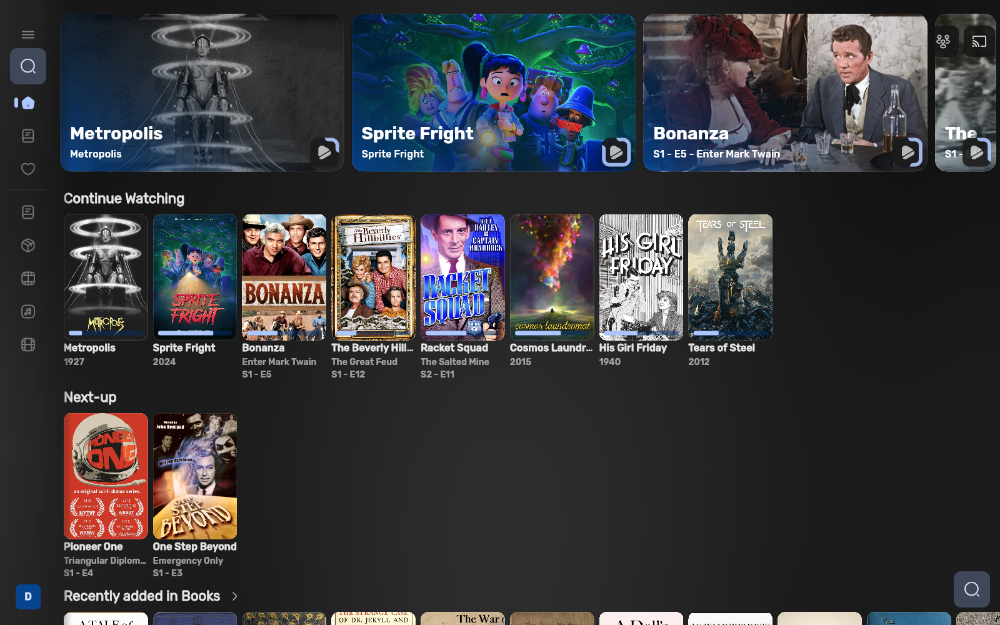
  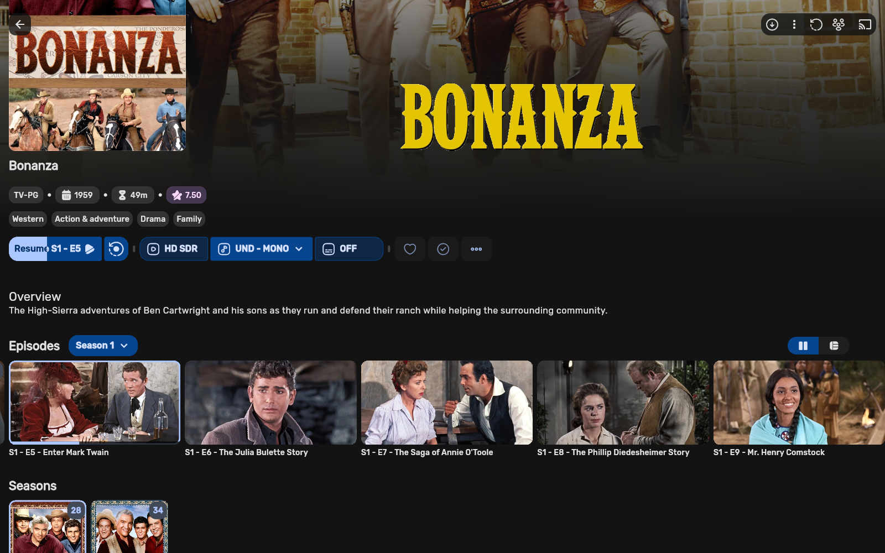
  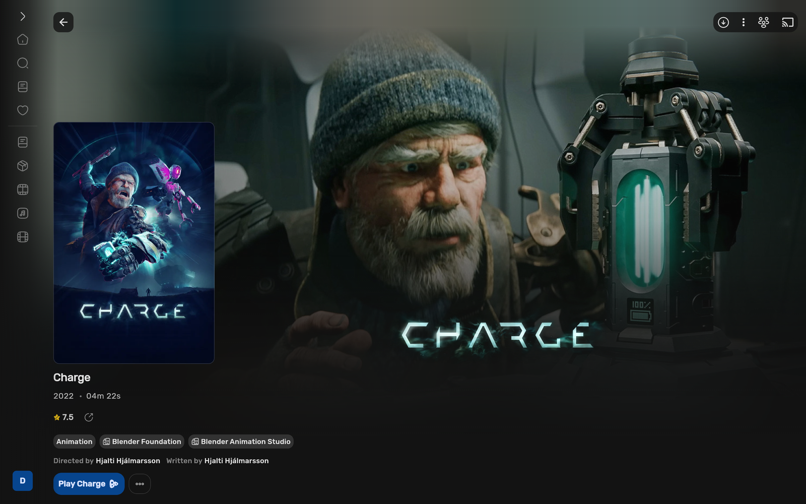

  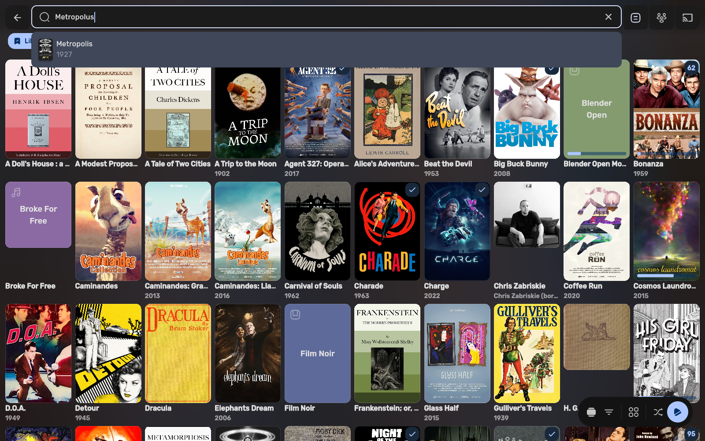
  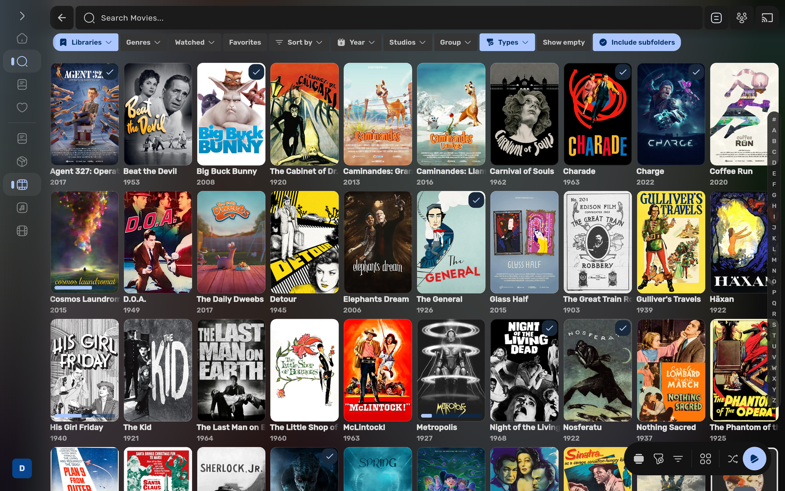
  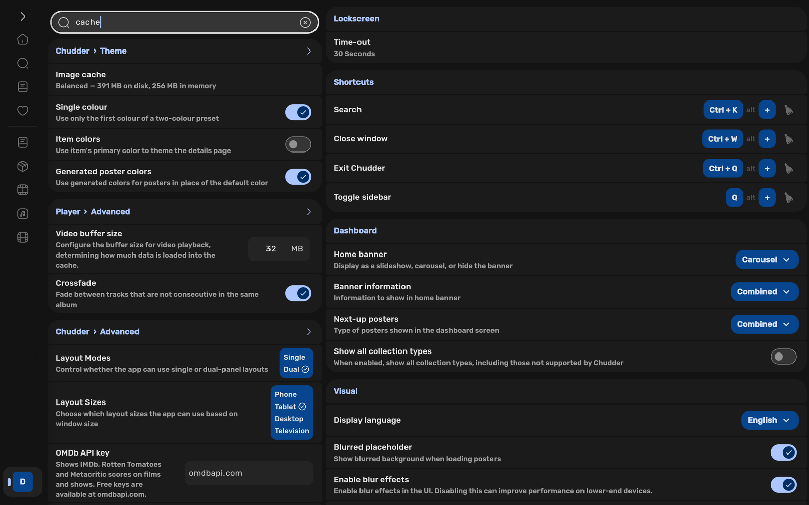

**Tablet**

  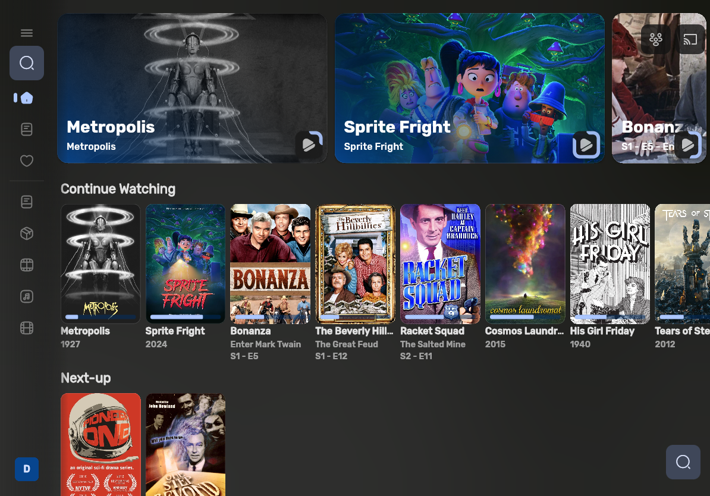
  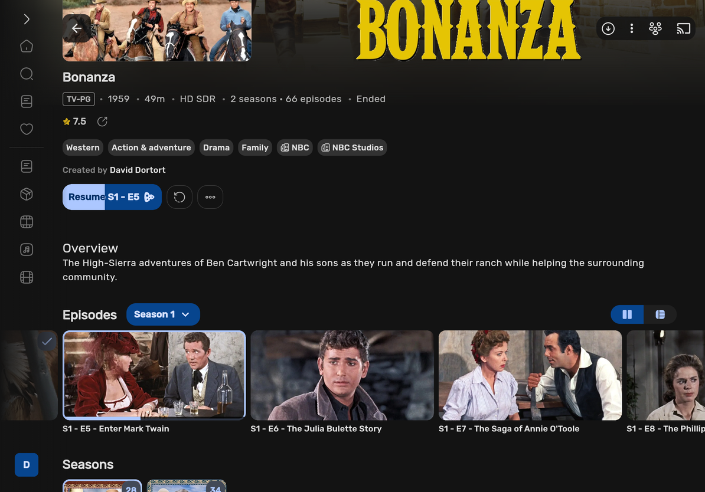
  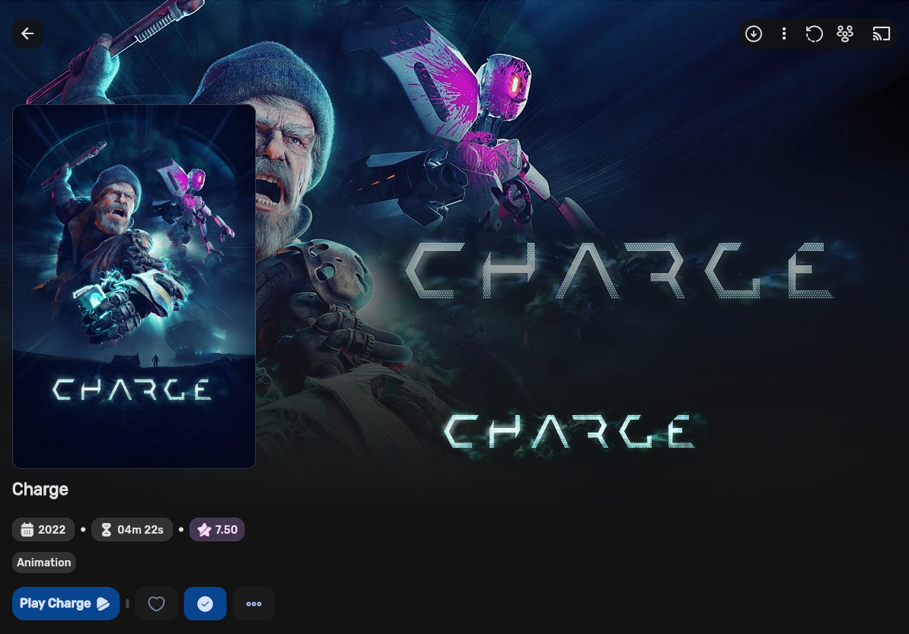

**Phone**

  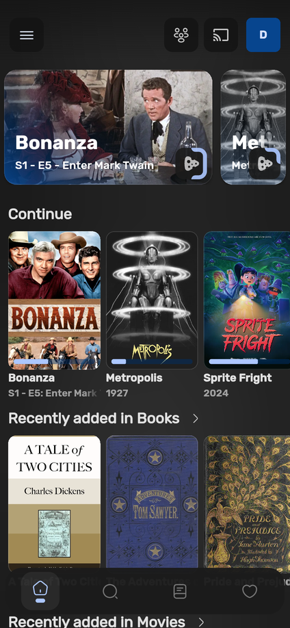
  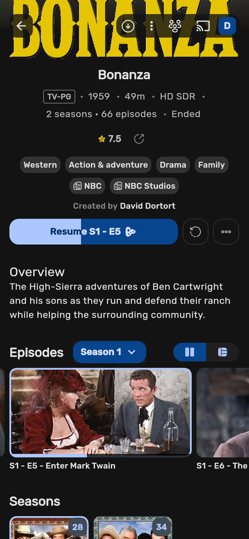
  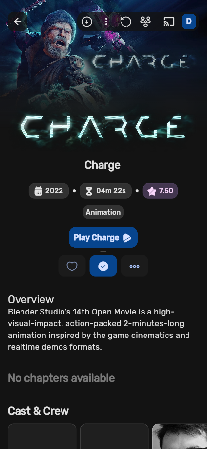

**Television**

Driven from a remote, so the focus ring shows where the d-pad is.

  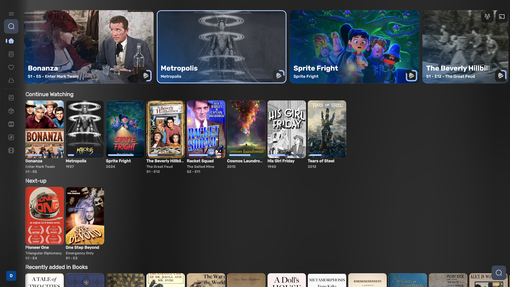
  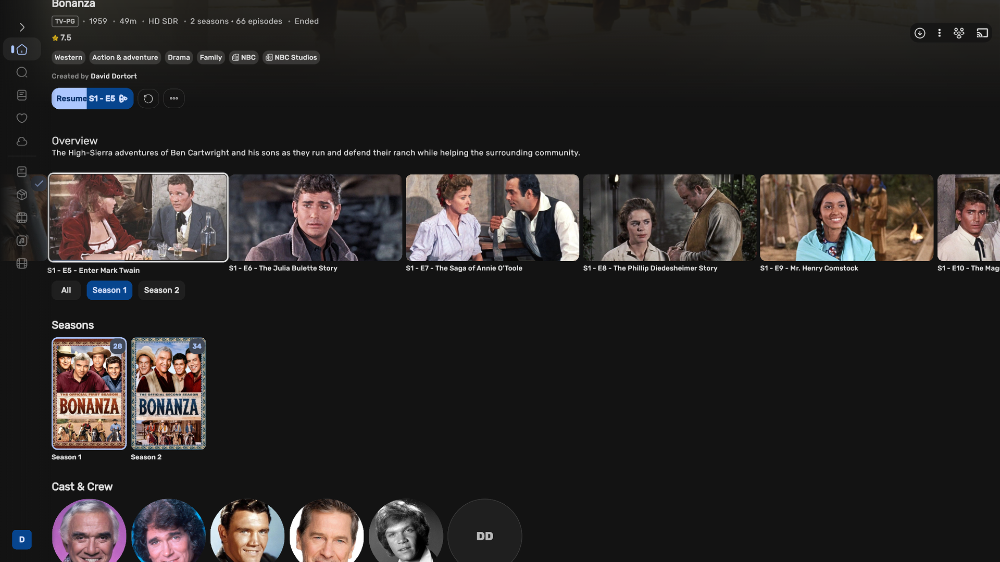
  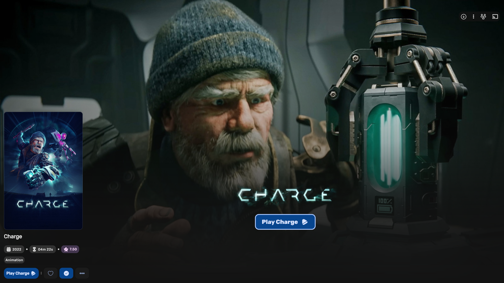

## Download

Everything comes from this repository's [releases page](https://github.com/JenteJan/Chudder/releases).
Platform notes live in [INSTALL.md](INSTALL.md).

| Platform | Get it |
| --- | --- |
| Windows | `Chudder-Windows-*-Setup.exe` (per-user installer) or the `.zip` for a portable copy |
| macOS | `Chudder-macOS-*.dmg` |
| Linux | `.AppImage`, `.flatpak` bundle, or the `.zip` |
| Android and Android TV | `Chudder-Android-*-arm64-v8a.apk` fits nearly every device, or add the repository to [Obtainium](https://github.com/ImranR98/Obtainium) for updates |
| iOS | `Chudder-iOS-*.ipa`, sideloaded with AltStore or Sideloadly |
| Web | Try it in the browser at [jentejan.github.io/Chudder](https://jentejan.github.io/Chudder/) against the public [Jellyfin demo server](https://demo.jellyfin.org/stable) (user `demo`, no password), or self-host the `Chudder-Web-*.zip` or the `ghcr.io/jentejan/chudder` image. Server on your own network? See the note in [INSTALL.md](INSTALL.md#web) |

> **Warning**
> Chudder is a personal fork. It tracks upstream Fladder but is not tested anywhere near
> as broadly, and it is primarily exercised on Windows and Android. If you want the
> stable, widely-tested option, use [Fladder](https://github.com/DonutWare/Fladder) — it
> is excellent and you will be in good hands.

> **Warning**
> (Windows) The installer is not code-signed, so SmartScreen will say "Windows protected
> your PC" the first time. Click **More info → Run anyway**. It installs per user, into
> `%LOCALAPPDATA%\Programs\Chudder`, and needs no administrator rights. Some Flutter
> applications are also flagged as false positives by Windows Defender — see
> [this upstream issue](https://github.com/DonutWare/Fladder/issues/197#issuecomment-2568906874)
> for background.

## Contributing

Contributions are genuinely welcome. This is an opinionated fork, but opinionated does
not mean closed.

### 🐛 Reporting bugs

Open an issue and I will do my best to fix it. Please check it has not already been
reported, and include the steps to reproduce it — that is the part that decides whether
a bug gets fixed this week or this month.

If the bug also exists in upstream Fladder, it is worth reporting it
[there](https://github.com/DonutWare/Fladder/issues) too; fixes that belong upstream I
will try to send upstream.

### 🚀 Pull requests

Pull requests are welcome. For anything large, open an issue first so we can agree on the
shape of it before you spend an evening on it — this fork has strong opinions about how
things should feel, and it would be a shame to find that out at review time.

Keep pull requests focused on one thing. It makes review faster and kinder.

### What I commit to

* **Fixing what gets raised.** Issues opened here get my honest best effort.
* **Staying in line with the official repo.** I track upstream Fladder and merge its
  changes in rather than drifting away from it. Bug fixes I make that are not
  taste-specific I will offer back upstream.
* **Fixing what I run into.** Most of what is in here started as something that annoyed
  me during ordinary use. That will continue.

## Credits

Chudder is a fork of **[Fladder](https://github.com/DonutWare/Fladder)** by
[**DonutWare**](https://github.com/DonutWare) / [PartyDonut](https://github.com/PartyDonut).

Essentially all of the hard work is theirs. Fladder is a polished, thoughtfully built
Jellyfin client, and everything here rests on years of it. This fork exists because the
foundation was good enough to be worth having opinions about. Thank you — sincerely.

If you want to support the work this is built on, the sponsor links on this repository go
to **the Fladder authors, not to me**. That is deliberate.

This software also uses:
- [Flutter](https://flutter.dev/)
- [Jellyfin](https://jellyfin.org/) — the server this is a client for

The showcase video in `assets/marketing` uses ["Werq"](https://incompetech.com/music/royalty-free/index.html?isrc=USUAN1500036)
by Kevin MacLeod (incompetech.com), licensed under [CC BY 4.0](http://creativecommons.org/licenses/by/4.0/),
and footage of [Caminandes: Llamigos](https://www.caminandes.com/) by the Blender Foundation (CC BY),
as served by the public Jellyfin demo server.

## License

Chudder is a modified version of Fladder and is licensed, as Fladder is, under the
**GNU General Public License v3.0**. See [LICENSE](LICENSE) for the full text.

The files in this repository have been modified from the Fladder originals; the commit
history records what changed and when.
